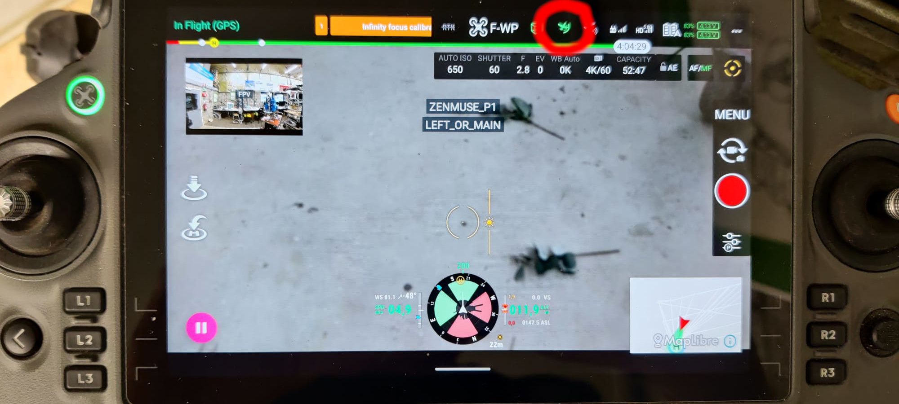
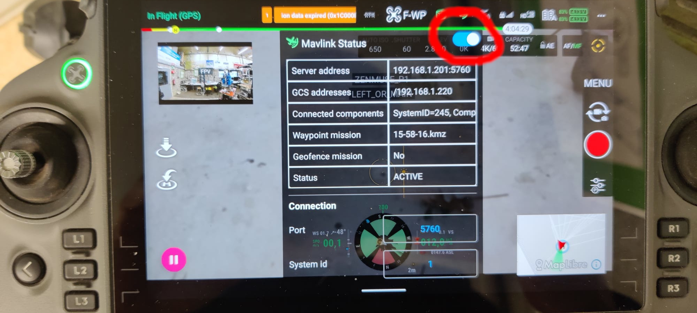

# MavDrone
Android application to control DJI drones using MAVLink.

> **⚠️ Caution:** Use this application at your own risk! Although DJI obstacle avoidance is enabled by default, **always test in simulator mode first.**
 
All drones compatible with DJI MSDK5 (version 5.17.0) should work. Drones with a :heavy_check_mark: are tested:
- Matrice 400
- Matrice 4D Enterprise Series
- DJI Mini4 PRO
- Matrice 4 Enterprise Series 
- H30 Series
- DJI Mini3 Pro
- DJI Mini3
- Mavic 3 Enterprise Series
- M30 Series
- M300 RTK :heavy_check_mark:
- Matrice 350 RTK :heavy_check_mark:
- DJI Mavic 3TA

## Features
- Control DJI drones using MAVLink protocol
- Support for DJI MSDK5
- Tested with Matrice 350 RTK and M300 RTK

## Installation
1. Install Android Studio
2. Install `adb`:
    ```bash
    sudo apt-get install android-tools-adb
    ```

3. Install UDEV rules for DJI Smart Controller:
    ```bash
    sudo cp misc/50-android.rules /etc/udev/rules.d
    sudo udevadm control --reload-rules
    ```

4. (Optionally) check if controller can be found by `adb`:
    ```bash
    adb devices
    ```
5. Inside [`app/src/main/res/values`](app/src/main/res/values) create a file `secrets.xml` with the following content:
   ```xml
   <?xml version="1.0" encoding="utf-8"?>
   <resources>
       <string name="dji_api_key" translatable="false">DJI_API_KEY</string>
       <string name="maplibre_token" translatable="false">MAPLIBRE_TOKEN</string>
   </resources>
   ```
    Change `DJI_API_KEY` with the API key from [DJI](https://developer.dji.com/) (App Type: `Mobile SDK`, App Name: `MavDrone`,  Package Name: `nl.wur.mavdrone`) and `MAPLIBRE_TOKEN` with a MapLibre-compatible token from
    [Mapbox](https://console.mapbox.com/account/access-tokens/) (the token starting with `sk.`).
6. Connect the Smart Controller to your computer
7. [Compile and upload](https://developer.android.com/studio/run) the application to your Smart Controller using Android Studio.

## Usage
1. [Force stop](https://support.dronelink.com/hc/en-us/articles/13139796197011-How-properly-close-the-DJI-Pilot-App-on-Remote-Controllers-with-Screens-DJI-monitors) the `DJI Pilot 2` drone app when opened.
2. Open the `MavDrone` app.  
3. Start the `MAVLink` connection by pressing the icon at the top:



4. Enable the server:



5. Test the application in simulator mode before flying. Refer to the DJI documentation for enabling simulator mode.

## Drone control
After enabling the MAVLink server, the drone exposes a server that accepts and processes MAVLink commands and messages. It tries to follow the `PX4` dialect, however not all functionalities are implemented yet.

For a detailed list of implemented MAVLink messages/commands and known differences from default MAVLink/PX4 behavior, see [doc/MAVLINK_COMPATIBILITY.md](doc/MAVLINK_COMPATIBILITY.md).

### Gimbal control (world-frame)
`MAV_CMD_DO_MOUNT_CONFIGURE` selects `YAW_FOLLOW` for any mount mode: gimbal yaw follows the aircraft while pitch and roll are held in the earth frame. `MAV_CMD_DO_GIMBAL_MANAGER_PITCHYAW` sets an earth-frame pitch in a single command: the value is converted with the aircraft attitude at command arrival, clamped to the product's controllable range, and then held by the DJI stabilizer (expect the product's slew time, e.g. ~2-3 s per 90°). Body-relative gimbal following is intentionally not emulated — DJI stabilizers hold the world frame and a software emulation cannot be deterministic. On products that do not provide the gimbal attitude key, `GIMBAL_DEVICE_ATTITUDE_STATUS` is synthesized from the last commanded world angle.

### Down-camera MJPEG stream
The down/FPV camera is served as an MJPEG stream at `http://<controller-ip>:8090/stream` (path is ignored), 640x480 @ ~15 fps. The native 16:9 source (853x480) is center-cropped to an exact 4:3 frame without rescaling, so calibrate camera intrinsics for this geometry (a center crop only shifts `cx`). Consumers behind an HTTP proxy must bypass it for this LAN address (FFmpeg honours `http_proxy`), see `down_cam_node.py` in the ground-side project for an example.

For an overview of the software architecture and module/class structure, see [doc/DESIGN_STRUCTURE.md](doc/DESIGN_STRUCTURE.md).

### Configure mavlink-router
The easiest way to connect to Python, ROS2, or QGroundControl is to use [`mavlink-router`](https://github.com/mavlink-router/mavlink-router). Create a file, `router.conf` with the following content (replace `<<server address of application>>` with the server address shown in the MavDrone app under [Usage](#usage)):
```ini
[General]
TcpServerPort = 0
MavlinkDialect = common

[UdpEndpoint QGroundControl]
Mode = Normal
Address = 127.0.0.1
Port = 14550

[UdpEndpoint MAVSDK]
Mode = Normal
Address = 127.0.0.1
Port = 14540

[TcpEndpoint Drone]
Mode = Normal
Address = <<server address of application>>
Port = 5760
```

Run `mavlink-router` using: 

```bash
mavlink-routerd -c router.conf
```

### Using Python
The [mavdrone_python](mavdrone_python) folder contains a simple Python library to control a DJI drone using 
Python and MavSDK. Install the library using:

```bash
pip install "mavdrone @ git+https://github.com/WUR-ABE/mavdrone.git@main#subdirectory=mavdrone_python"
```

See the [examples](mavdrone_python/examples) folder for some example applications.

### Using ROS2
ROS2 support is provided in [mavdrone_ros2](mavdrone_ros2).

For installation, configuration, launch, and camera calibration details, see [mavdrone_ros2/README.md](mavdrone_ros2/README.md).

### Using QGroundControl
QGroundControl should automatically connect to `mavlink-router`. If you are not using `mavlink-router`, go to `Application Settings` →  `Comm Links` → `Add New Link` and set type to `TCP`, `Server Address` to the server address of the application and port to `5760`. 

> **ℹ️ Note:** Starting a waypoint mission is [not possible](https://github.com/mavlink/qgroundcontrol/issues/9603) from QGroundControl. After uploading the mission, you can start the mission from the bottom-left part of the screen.

## Development
We are not planning to actively develop this application. Feel free to fork this repository.

> **💡 Remark:** To update the UXSDK, copy all files of [`android-sdk-v5-uxsdk`](https://github.com/dji-sdk/Mobile-SDK-Android-V5/tree/dev-sdk-main/SampleCode-V5/android-sdk-v5-uxsdk) to [`uxsdk`](uxsdk). Update the [dependencies](gradle/libs.versions.toml) according to the dependencies in the [`dependencies.gradle`](https://github.com/dji-sdk/Mobile-SDK-Android-V5/blob/dev-sdk-main/SampleCode-V5/android-sdk-v5-as/dependencies.gradle) file of the UXSDK. After updating the UXSDK, apply the following patches:
> ```bash
> git apply misc/*.patch
> ```

## License
This project is licensed under the GNU Affero General Public License v3.0 (AGPL-3.0-or-later).

Third-party components:
* The folder `uxsdk/` contains code licensed under the MIT License. See [`uxsdk/LICENSE`](uxsdk/LICENCE) for details.
* The folder `mavlink/` contains code licensed under the MIT License. See [`mavlink/LICENSE`](mavlink/LICENCE) for details.

## Funding
This research is part of the research program SYNERGIA, funding was obtained from the Dutch Research Council (NWO grant 17626), IMEC-One Planet and other private parties.

 &nbsp;&nbsp;&nbsp; 