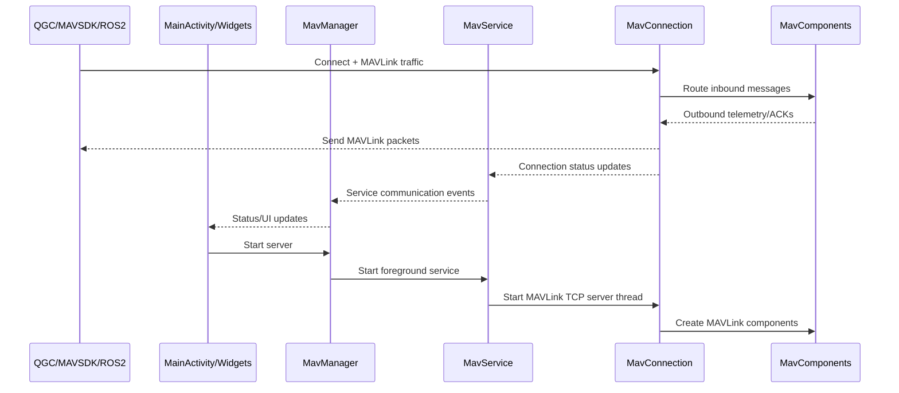
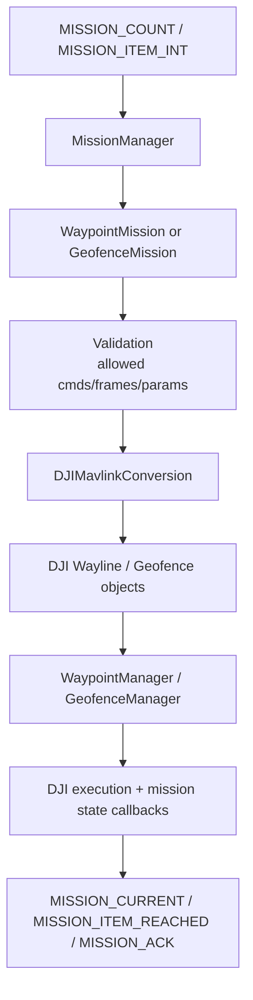
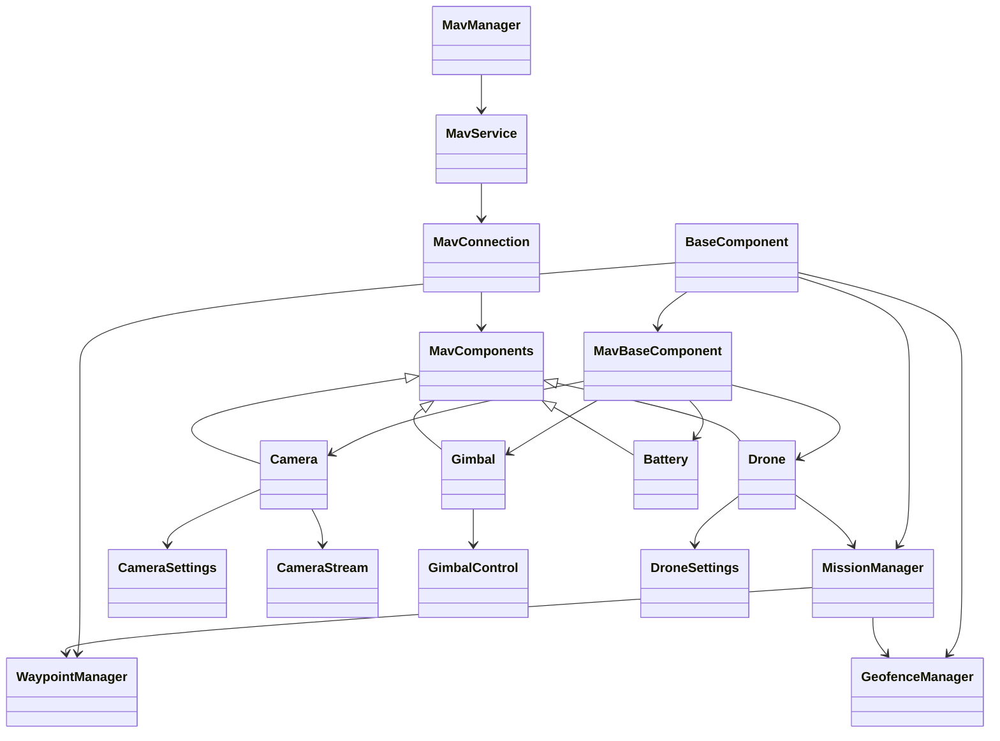

# MavDrone structure

This document describes the code structure and runtime design of MavDrone, with a focus on the Android MAVLink server implementation.

## Architecture drawings

### 1. Runtime sequence (high level)

### 2. Mission conversion pipeline

### 3. Full class hierarchy (MAVLink server)

